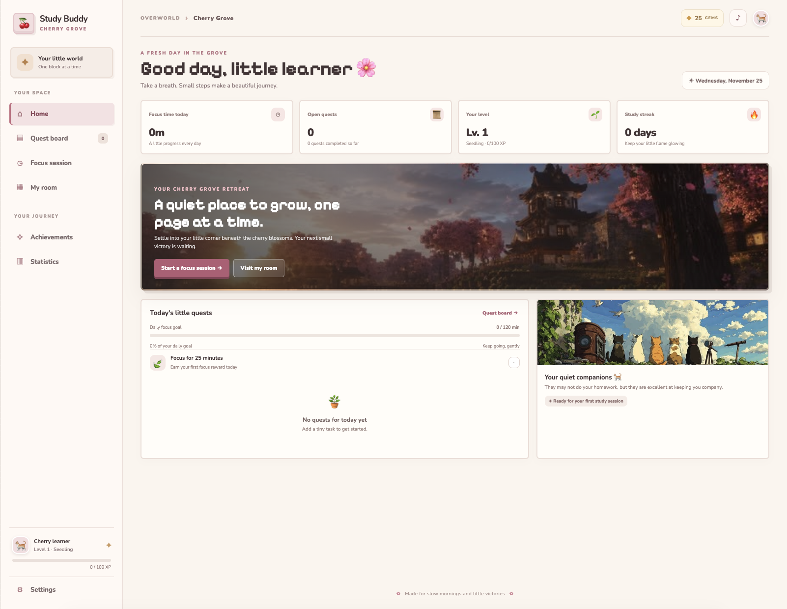

# Study Buddy — Cherry Grove

A cozy, Minecraft-inspired study companion built with plain HTML, CSS and JavaScript.

## Preview



*Current dashboard preview of the Cherry Grove study room.*

## Features

- Focus timer with focus and short-break modes.
- Quest board with subjects, due dates, priorities and completion rewards.
- XP, levels, gems and achievement badges.
- A small room inventory and decoration shop.
- Daily study goal, streak tracking and 7-day study statistics.
- Original browser-synthesized ambient music and UI sound effects.
- LocalStorage persistence — no account or server required.
- Responsive layout for desktop and mobile.

## Run locally

1. Unzip the project.
2. Open a terminal in the `StudyBuddy_Minecraft` folder.
3. Run a local static server:

   ```bash
   python3 -m http.server 8000
   ```

4. Open `http://localhost:8000` in your browser.

You can also open `index.html` directly, but a local server is the recommended way to run it.

## Data storage

This version stores data in the browser's LocalStorage. It does not use the previous SQLite database. The SQLite database uploaded with the original Streamlit app contained the `tasks` and `study_sessions` tables but no records, so there was no existing task or session data to migrate.

Data is local to the browser and browser profile. Clearing site data can erase progress. Export/import is not included in this first web version.

## Images

The four images in `assets/images/` were supplied by the project owner and are used as the Cherry Grove landscape and companion artwork. Keep their original source/permission details with the project if you publish it.

Additional Minecraft Cherry Grove visual references were reviewed during development, including Mojang's official [Around the Block: Cherry Grove](https://www.minecraft.net/en-us/article/around-block--cherry-grove) article. Other visual inspiration included cherry cottage and interior builds from Minecraft community sites. Third-party screenshots and builds were not copied into this repository because their reuse permissions were not established.

If you share this fan-made app publicly, make sure the supplied images are yours to redistribute and follow the current [Minecraft Usage Guidelines](https://www.minecraft.net/en-us/usage-guidelines). This project is unofficial and is not approved by, associated with, or endorsed by Mojang or Microsoft.

## Audio

The app generates a soft ambient loop and interface chimes with the browser Web Audio API. It does not bundle Minecraft's extracted music or sound-effect files. Browsers require a user interaction before audio can start; use the music button in the top bar or Sound & ambience settings.

## Launch on macOS

You can double-click `Start Study Buddy.command` to start a local server and open the app in your browser. Keep the Terminal window open while using it; press Control+C to stop the server. If macOS blocks the script, use the manual `python3 -m http.server 8000` command above.

## Project structure

```text
StudyBuddy_Minecraft/
├── Start Study Buddy.command
├── ASSET_NOTES.md
├── index.html
├── css/
│   └── style.css
├── js/
│   ├── app.js
│   └── audio.js
├── assets/
│   ├── images/
│   └── audio/       # reserved for future licensed audio files
├── README.md
└── legacy_streamlit/   # original uploaded app and database backup
```
